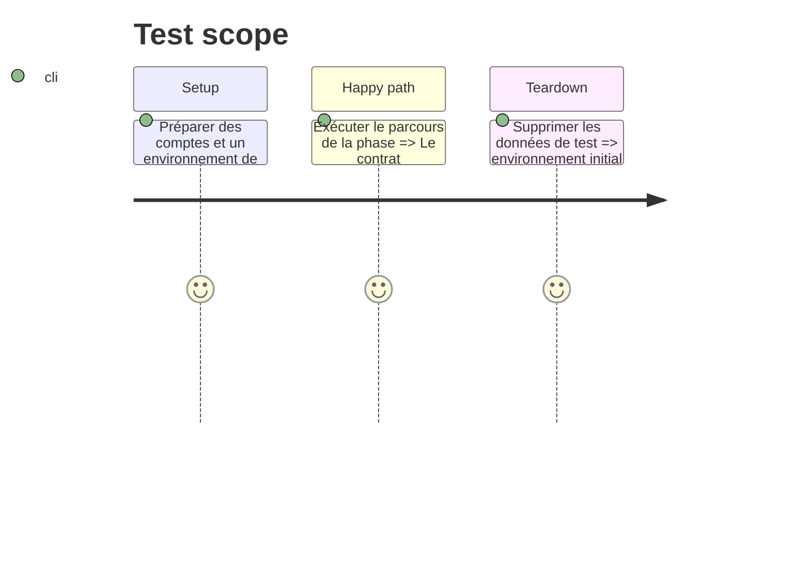

# Instruction : Architecture et décisions de sécurité

## Architecture projection

> ✅ créer · ✏️ modifier · ❌ supprimer

```txt
✏️ docs/guide/modele-metier.md — périmètre des comptes
✅ docs/guide/authentification.md — contrat et décisions retenues
```

## Test Scope



## Tasks to do

### `1)` Architecture et décisions de sécurité

> Réaliser la phase et préserver les modifications existantes.

1. Relever la topologie réelle et prévue des domaines et du proxy ; définir le parcours d’un cookie de session et le routage Next.js–Symfony, sans supposer que localhost et production se comportent pareil.
2. Définir HTTPS, cookies HttpOnly/Secure/SameSite, origine, CORS éventuel, CSRF, URL de retour et stockage partagé des sessions et limites selon la topologie.
3. Faire préciser la durée de session, la récupération du compte et du mot de passe, la configuration e-mail et l’éventuelle double authentification. Aucun lien e-mail ne doit contourner une double authentification retenue.

## Test acceptance criteria

| Task | Acceptance criteria |
| --- | --- |
| 1 | Le contrat d’authentification et les décisions bloquantes sont explicites et compatibles avec le déploiement. |
