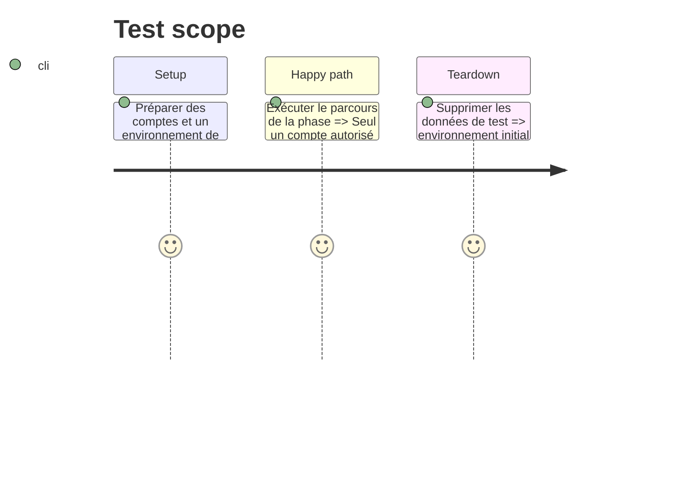

# Instruction : Compte administrateur et accès par mot de passe

## Architecture projection

> ✅ créer · ✏️ modifier · ❌ supprimer

```txt
✅ back/src/Entity/ — compte administrateur
✅ back/src/Security/ et back/src/Command/ — authentification et création contrôlée
✅ back/migrations/ — schéma de compte
✏️ back/config/packages/ et back/composer.json — composants et sécurité
```

## Test Scope



## Tasks to do

### `1)` Compte administrateur et accès par mot de passe

> Réaliser la phase et préserver les modifications existantes.

1. Créer le compte et ses droits, sans inscription publique ; générer et examiner la migration.
2. Prévoir une commande sécurisée de création et de changement de mot de passe sans secret dans les arguments ou journaux ; hacher avec le mécanisme Symfony.
3. Protéger les routes et opérations, gérer session, expiration, renouvellement à la connexion, déconnexion, CSRF et limitation des tentatives ; réponses génériques.
4. Prévoir un journal minimal de connexions et une politique de conservation validée.

## Test acceptance criteria

| Task | Acceptance criteria |
| --- | --- |
| 1 | Seul un compte autorisé peut créer une session et accéder aux opérations administratives. |
