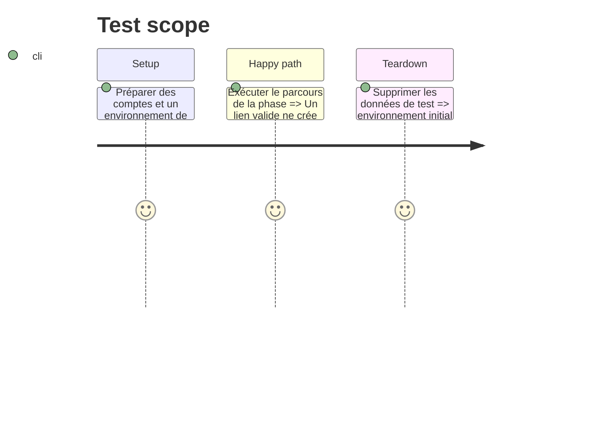

# Instruction : Lien de connexion par e-mail

## Architecture projection

> ✅ créer · ✏️ modifier · ❌ supprimer

```txt
✅ back/src/Controller/ et back/src/Security/ — demande et validation du lien
✏️ back/config/packages/ — authentification, mail et limitation
✏️ compose.yaml — transport de test local si nécessaire
```

## Test Scope



## Tasks to do

### `1)` Lien de connexion par e-mail

> Réaliser la phase et préserver les modifications existantes.

1. Mettre en place l’envoi par un transport configurable et un système local de test sans envoi réel ; limiter les demandes et retourner une réponse identique pour une adresse inconnue.
2. Configurer un lien signé valable 900 secondes et une utilisation maximum, avec stockage fiable des utilisations ; gérer expiration, rejeu et invalidation.
3. Éviter la consommation par les scanners de messagerie : page intermédiaire puis validation explicite par POST ; ne pas exposer le lien dans les journaux ou à des tiers.
4. Tester la reprise en cas d’échec d’envoi et la cohérence avec toute seconde étape retenue.

## Test acceptance criteria

| Task | Acceptance criteria |
| --- | --- |
| 1 | Un lien valide ne crée qu’une session, après confirmation, et un lien expiré ou réutilisé est refusé. |
