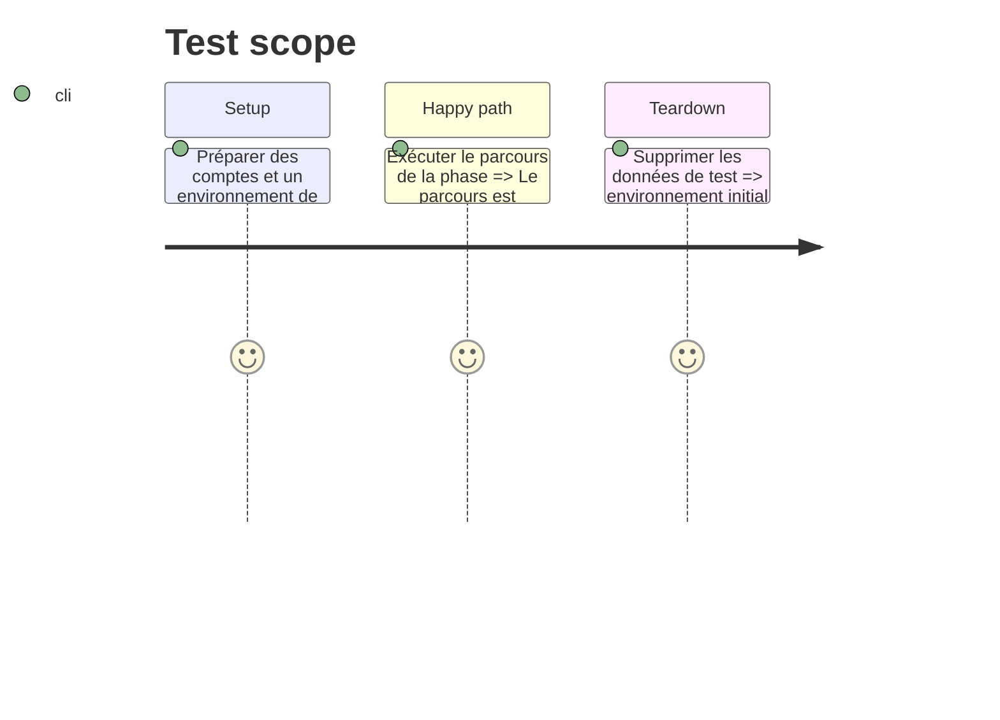

# Instruction : Interface et intégration

## Architecture projection

> ✅ créer · ✏️ modifier · ❌ supprimer

```txt
✅ front/app/ — pages et composants de connexion et d’administration
✏️ front/ — routage ou proxy selon contrat retenu
✏️ back/ — points d’accès nécessaires à la session
```

## Test Scope



## Wireframe

```txt
L’ATELIER — Nom de l’artiste
Espace de gestion du site
Adresse e-mail : [____________________]
[ RECEVOIR LE LIEN ]
Utiliser un mot de passe
Accès réservé · aide au contact
```

Esquisse tirée de la maquette Penpot ; vérifier les états et le design system avant réalisation.

## Tasks to do

### `1)` Interface et intégration

> Réaliser la phase et préserver les modifications existantes.

1. Lire front/AGENTS.md et inspecter la maquette de connexion ; appliquer le design system en TypeScript et SCSS.
2. Construire le formulaire e-mail, la confirmation neutre, l’option mot de passe, les erreurs accessibles et la déconnexion.
3. Intégrer la session selon le contrat de la phase 1 et vérifier les états non authentifiés, expiration et rafraîchissement ; ne pas stocker de secret dans localStorage.

## Test acceptance criteria

| Task | Acceptance criteria |
| --- | --- |
| 1 | Le parcours est utilisable au clavier et la session fonctionne entre le front et le backend. |
