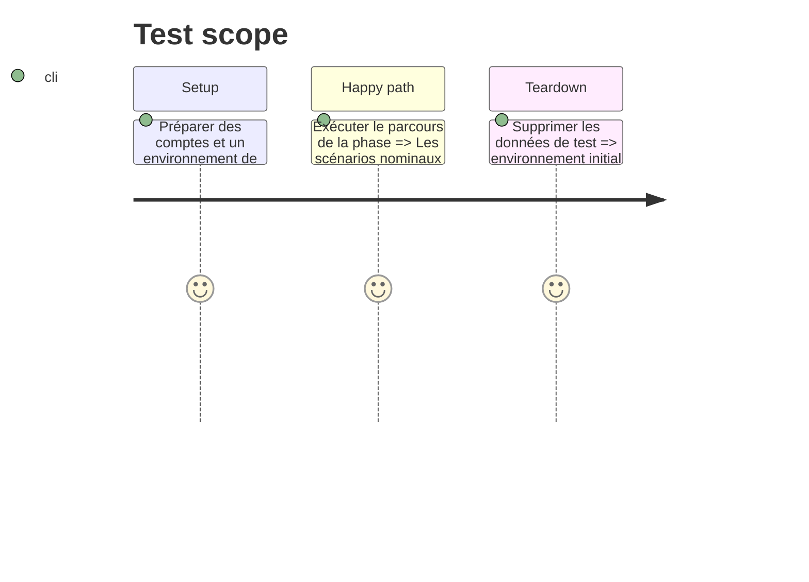

# Instruction : Vérification de bout en bout et documentation

## Architecture projection

> ✅ créer · ✏️ modifier · ❌ supprimer

```txt
✅ back/tests/ — tests de sécurité et intégration
✅ front/ tests ou parcours de vérification — selon outils retenus
✏️ docs/guide/authentification.md et docs/guide/verifications.md — procédures et limites
```

## Test Scope



## Tasks to do

### `1)` Vérification de bout en bout et documentation

> Réaliser la phase et préserver les modifications existantes.

1. Tester compte inconnu, mauvais mot de passe, limitation, lien expiré ou réutilisé, CSRF, droits insuffisants, déconnexion et invalidation de session.
2. Vérifier le parcours réel navigateur vers Symfony avec transport e-mail de test et MySQL isolé ; contrôler les cookies et le refus direct des endpoints sans droits.
3. Documenter création et récupération de compte, configuration des secrets et du transport, prérequis HTTPS, exploitation et sauvegarde ; compiler VitePress.
4. Signaler les contrôles impossibles ; ne pas annoncer le mécanisme validé sans test de bout en bout.

## Test acceptance criteria

| Task | Acceptance criteria |
| --- | --- |
| 1 | Les scénarios nominaux et de refus passent et les procédures décrivent le système réellement installé. |
