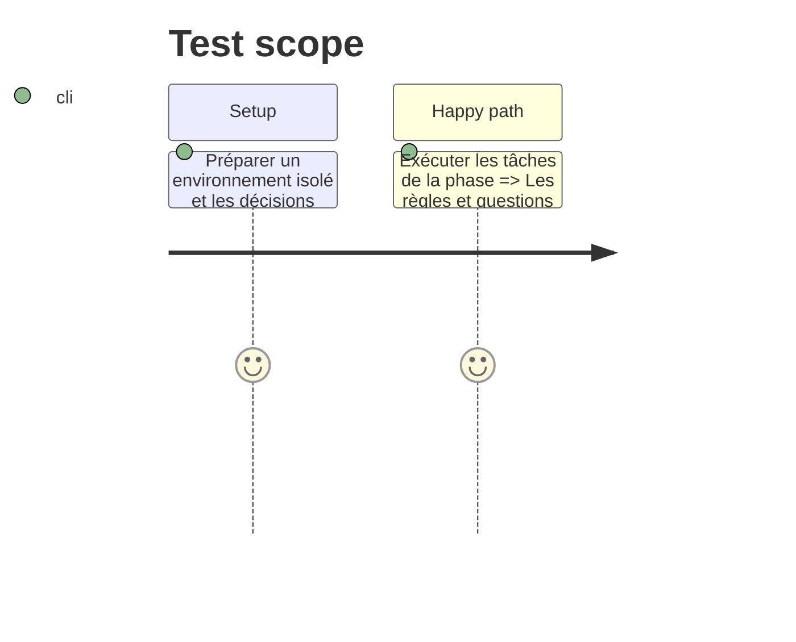

# Instruction : Valider les règles du modèle

## Architecture projection

> ✅ créer · ✏️ modifier · ❌ supprimer

```txt
✏️ docs/guide/modele-metier.md — confirmer les champs et invariants
✏️ docs/guide/projet.md — consigner les décisions complémentaires si nécessaire
```

## Test Scope



## Tasks to do

### `1)` Valider les règles du modèle

> Réaliser la phase sans écraser les changements existants.

1. Revoir les champs proposés avec les maquettes et conserver les décisions existantes.
2. Trancher avec l’utilisateur les choix métier qui conditionnent le schéma : URL, prix et unités, publication, corbeille, suppression et texte alternatif ; distinguer les décisions techniques réversibles.
3. Définir types, nullabilité, unicité, ordre et langue des champs ; ne pas supposer que les exemples Penpot sont des règles.

## Test acceptance criteria

| Task | Acceptance criteria |
| --- | --- |
| 1 | Les règles et questions bloquantes sont identifiées et les champs retenus sont cohérents avec les écrans. |
