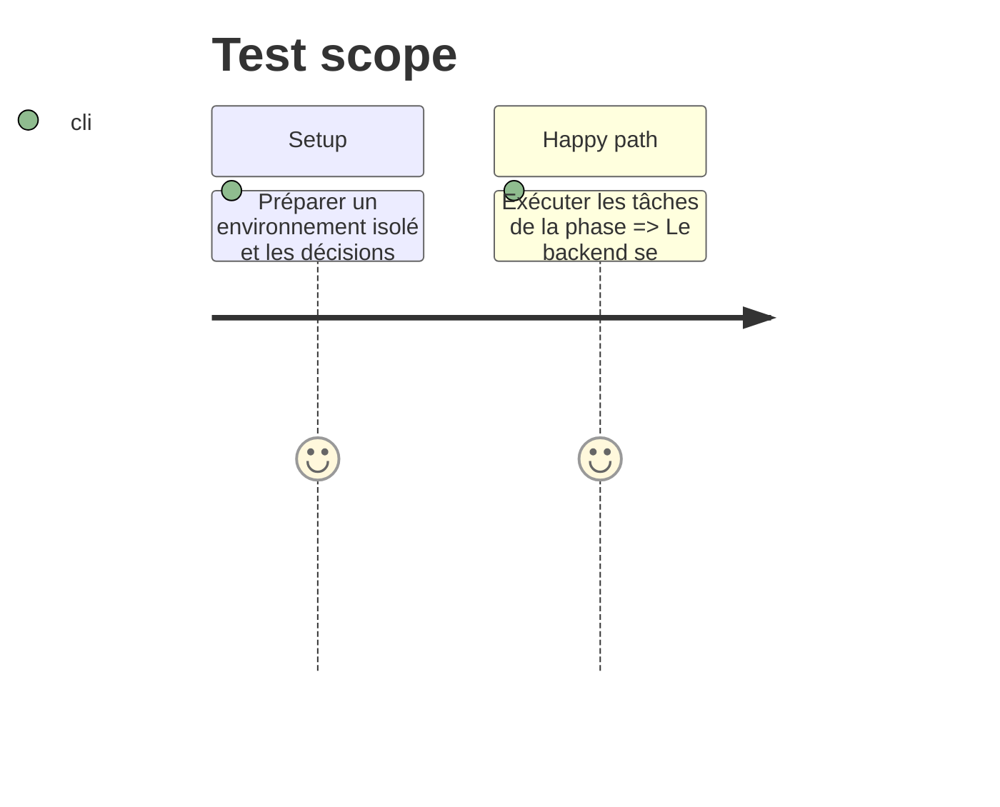

# Instruction : Vérifier MySQL et Doctrine

## Architecture projection

> ✅ créer · ✏️ modifier · ❌ supprimer

```txt
✏️ compose.yaml — service MySQL, persistance et disponibilité
✏️ back/Dockerfile — pilote PDO MySQL
✏️ back/.env et back/config/packages/doctrine.yaml — connexion et configuration
✏️ back/composer.json, back/composer.lock et back/symfony.lock — dépendances si correction nécessaire
✏️ docs/guide/developpement.md — procédure de démarrage
```

## Test Scope



## Tasks to do

### `1)` Vérifier MySQL et Doctrine

> Réaliser la phase sans écraser les changements existants.

1. Examiner les modifications déjà présentes sans les écraser ; démarrer Compose dans un environnement autorisé.
2. Vérifier connexion Doctrine à MySQL, encodage utf8mb4, disponibilité et persistance après redémarrage.
3. Vérifier les paramètres et secrets de développement, et distinguer les réglages de production.

## Test acceptance criteria

| Task | Acceptance criteria |
| --- | --- |
| 1 | Le backend se connecte à MySQL et les données de test persistent après redémarrage. |
