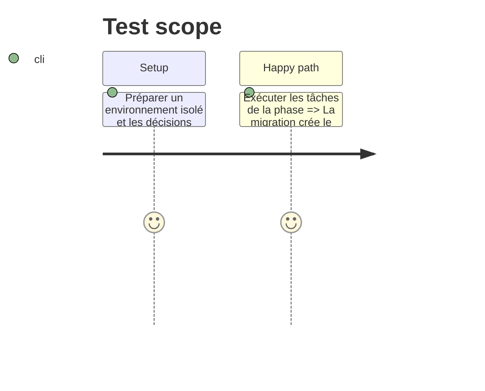

# Instruction : Implémenter les entités et migrations

## Architecture projection

> ✅ créer · ✏️ modifier · ❌ supprimer

```txt
✅ back/src/Entity/ — classes métier et relations
✅ back/migrations/ — migration initiale
✏️ back/config/packages/doctrine.yaml — seulement si nécessaire
✏️ docs/guide/modele-metier.md — état réel du schéma
```

## Test Scope



## Tasks to do

### `1)` Implémenter les entités et migrations

> Réaliser la phase sans écraser les changements existants.

1. Créer les entités Œuvre, Série, Catégorie et Média selon les règles validées ; conserver les deux ordres distincts.
2. Définir les relations et contraintes, notamment série facultative et catégories multiples ; garantir que la pièce maîtresse appartient à sa série par une règle applicative adaptée.
3. Générer une migration révisée, l’appliquer à une base vide puis vérifier le schéma ; documenter ce qui est réellement réalisé.

## Test acceptance criteria

| Task | Acceptance criteria |
| --- | --- |
| 1 | La migration crée le schéma attendu et les métadonnées Doctrine sont cohérentes. |
